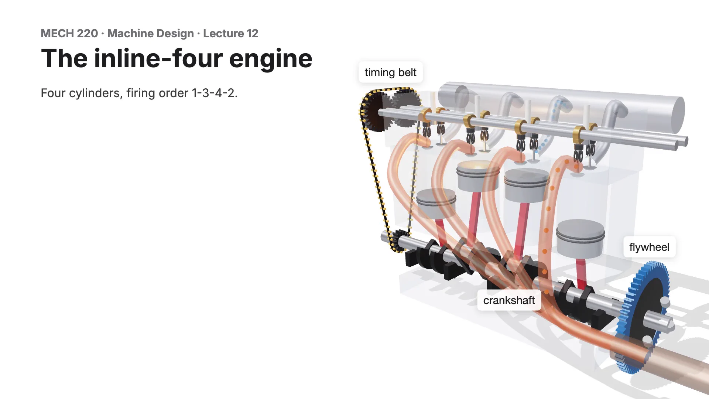
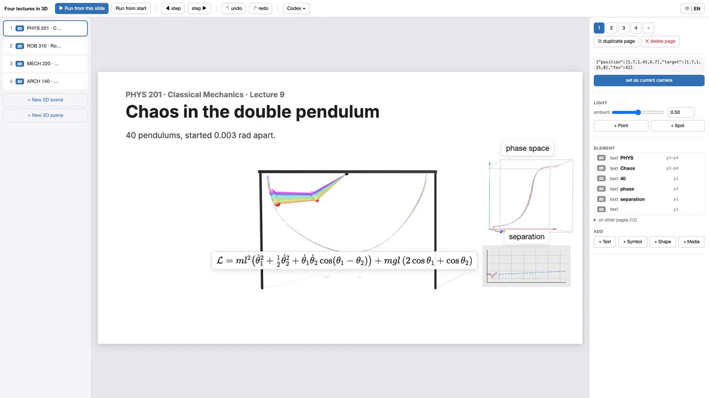
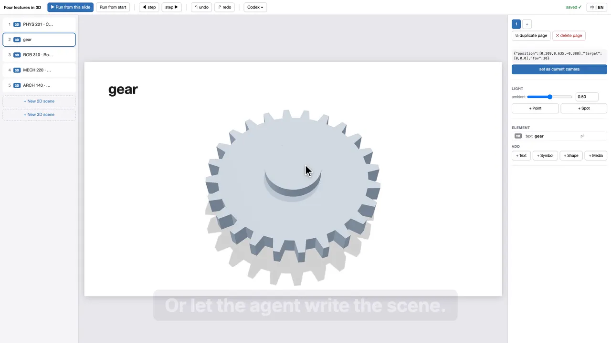
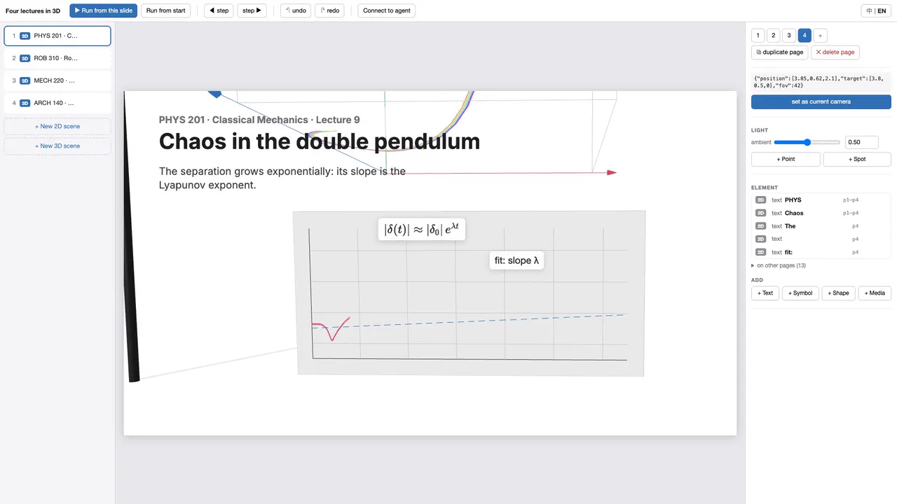
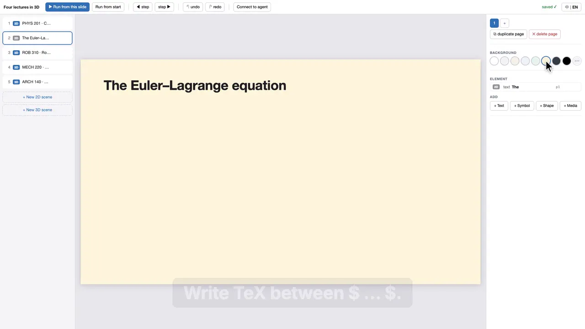
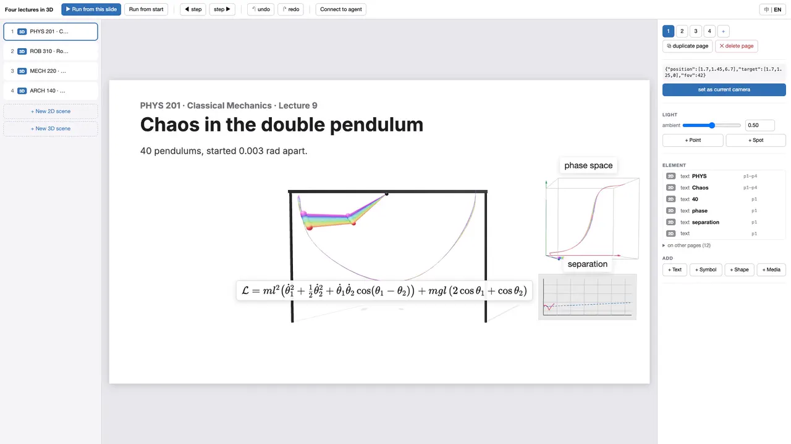
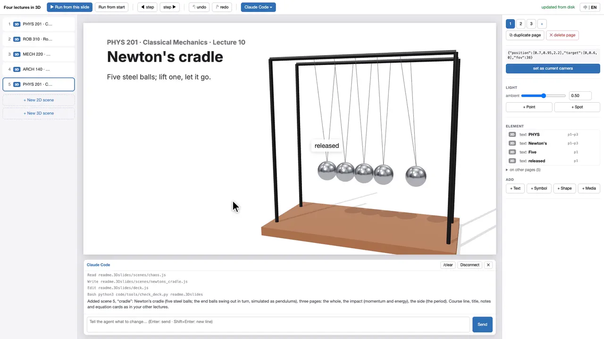

<p align="right"><b>English</b> | <a href="README.zh-CN.md">简体中文</a></p>

# 3D Slides

**Slides that aren't flat.** Every slide can be a living 3D scene: fly the camera from page to page, light it,
drop in your own models, mix it with ordinary 2D slides, and present it all in the browser. An AI agent can
build scenes and pages for you, and it remembers your style.

Made by [Yuanbo Li](https://liyb2002.github.io/).

## How to use

1. Clone this repo.
2. Run `zsh code/tools/make_app.sh` (once) or `python3 code/serve.py`.
3. Double-click any `.3Dslides` file (for example `showcase.3Dslides`), or open http://localhost:8000/.

## Features

### 1. A slide is a 3D scene, and you can look around in it
While presenting, drag to turn the view and scroll to zoom, live, in front of your audience. Press **R** to glide back.



### 2. Add a page: move the camera, save the view
A page is a camera view. Add a page, move to where you want to look, and click **set as current camera**.
When you click through, the camera flies from one page to the next.


### 3. Lights
Turn the ambient light down, then add spot and point lights on any page. Drag them in the scene and set their
colour, strength and width.


### 4. New 3D and 2D scenes
**+ New 3D scene**: upload a model (stl, obj, ply, glb, gltf, 3mf) and get a 3D scene of it, ready to turn around.



Or choose **Generate** and tell the agent what the scene should show: it writes the scene for you.



**+ New 2D scene**: an ordinary slide with text, pictures and video, with a background colour you pick.
Going from a 3D scene to a 2D slide is one click.



### 5. Write TeX
Put TeX between `$...$` in any text box. It is typeset when you finish editing.



### 6. Ask the agent, and it remembers your preferences
**Connect to agent** runs [Claude Code](https://claude.com/claude-code) or [Codex](https://github.com/openai/codex)
on your own machine (installed and logged in). Ask for a new scene or new pages and they appear in your deck.



When you close the panel, it offers to remember the style you asked for (fonts, layout, colours) in
`user/user_skills/`, so next time it starts in your style.



## In the editor

| | |
|---|---|
| **P** / **Shift+P** | present from this page / from the start (**Esc** comes back) |
| **→** / **←** | next / previous page |
| drag, scroll | turn and zoom the 3D view (shift-drag: move it) |
| shift / ⌘-click, or a box drag on a 2D slide | select several elements; drag one to move them all |
| ⌘A, ⌘C, ⌘V, ⌘G, Delete | select all, copy, paste, group, delete |
| ⌘Z / ⌘⇧Z | undo / redo |
| drag a scene in the left list | change the order of the scenes |
| 中 \| EN (top right) | the editor in Chinese or English |

## How a talk is stored

A talk is a folder, `<name>.3Dslides/` (Finder shows it as one file once the app is made):

```
showcase.3Dslides/
  deck.js          the talk: an ES module exporting the slides (you can edit it by hand)
  overrides.json   editor edits that are not written into deck.js yet
  scenes/          the 3D scenes used by deck.js (three.js)
  assets/          models, pictures, videos, uploads
```

Edits made in the editor are written straight back into `deck.js` where they can be. Every open editor and
presenter tab updates live when the files change.

Two talks come with it: `showcase.3Dslides`, four short lectures (chaos in the double pendulum, a dexterous robot
hand, an inline-four engine, Notre-Dame), and `demo.3Dslides`, a walk through Van Gogh's paintings.
