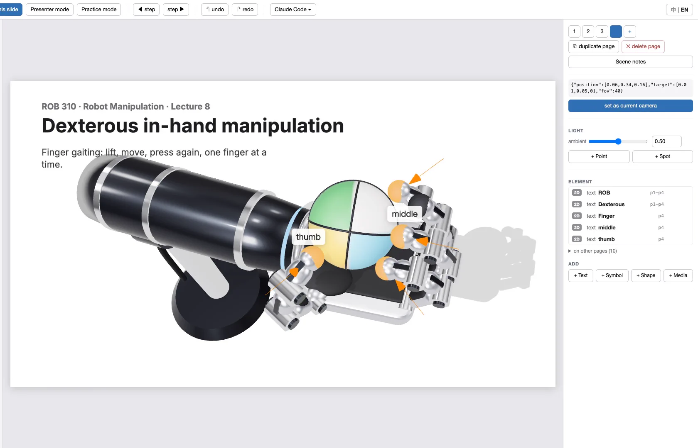
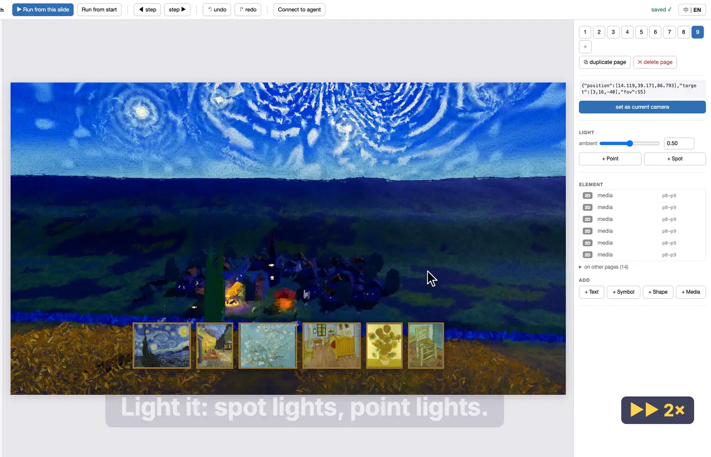
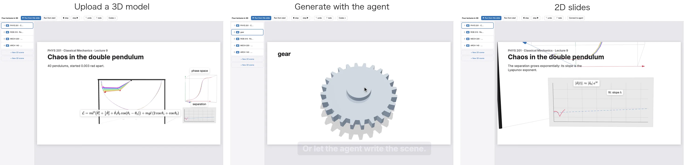
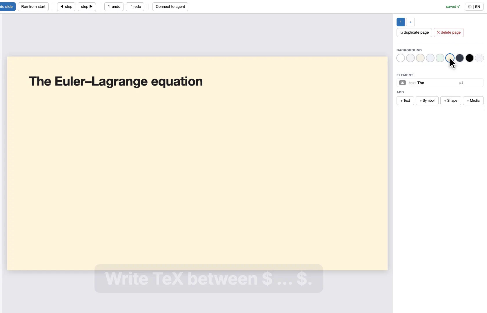
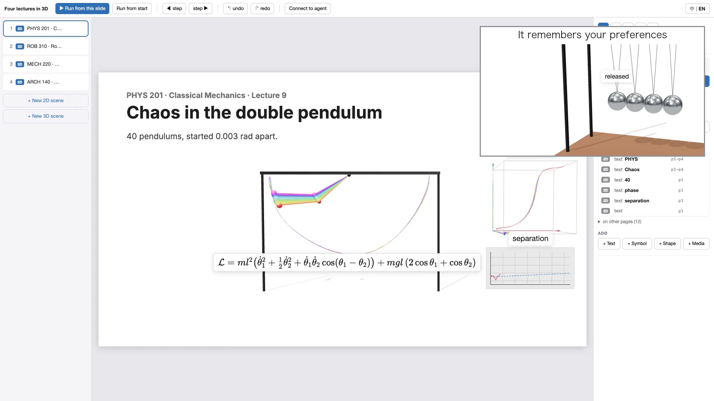
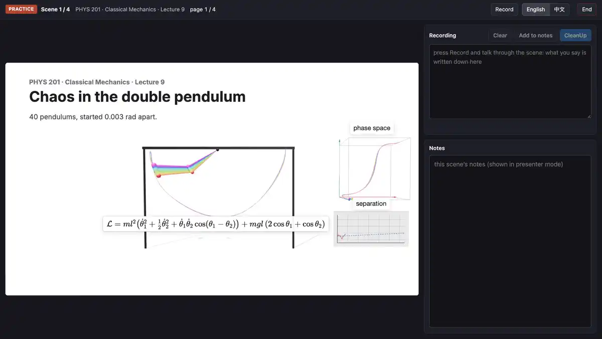

<b>English</b> | <a href="README.zh-CN.md">简体中文</a>

# 3D Slides

**Slides that aren't flat.** Every slide can be a living 3D scene: fly the camera from page to page, light it,
drop in your own models, mix it with ordinary 2D slides, and present it all in the browser. An AI agent can
build scenes and pages for you, and it remembers your style.

Made by [Yuanbo Li](https://liyb2002.github.io/). Feel free to fork it and build your own version; just give me credit.

## How to use

1. Clone this repo.
2. Run `zsh code/tools/make_app.sh` (once) or `python3 code/serve.py`.
3. Double-click any `.3Dslides` file (for example `showcase.3Dslides`), or open http://localhost:8000/.

## Features

### 1. A slide is a 3D scene, and you can look around in it
While presenting, drag to turn the view and scroll to zoom; press **R** to glide back.

### 2. Add a page: move the camera, save the view
A page is a camera view: move to where you want to look and click **set as current camera**. Clicking through, the camera flies from page to page.

### 3. Lights
Add spot and point lights on any page, and set their colour, strength and width.

### 4. New scenes
Upload a 3D model, or let the agent generate the scene. Of course, you can use 2D slides too.

### 5. Write TeX
Put TeX between `$...$` in any text box.

### 6. Ask the agent, and it remembers your preferences
**Connect to agent** runs [Claude Code](https://claude.com/claude-code) or [Codex](https://github.com/openai/codex) on your machine to build scenes and pages for you. It remembers your style in `user/user_skills/`.

### 7. Practice mode: speak, and your notes are written for you
**Practice mode** listens while you talk through each scene (speech recognition in Chrome, English or Chinese) and writes down what you say. Add it to the scene's notes as it is, or press **CleanUp**: the agent takes out the fillers and repeats and keeps your own words. Notes follow the scene, not the page; **Presenter mode** shows them next to a small slide, with the full-screen slide in a second window.

## In the editor

| | |
|---|---|
| **P** / **Shift+P** | present from this page / presenter mode (**Esc** comes back) |
| **→** / **←** | next / previous page |
| drag, scroll | turn and zoom the 3D view (shift-drag: move it) |
| shift / ⌘-click, or a box drag on a 2D slide | select several elements; drag one to move them all |
| ⌘A, ⌘C, ⌘V, ⌘G, Delete | select all, copy, paste, group, delete |
| ⌘Z / ⌘⇧Z | undo / redo |
| drag a scene in the left list | change the order of the scenes |
| 中 \| EN (top right) | the editor in Chinese or English |
