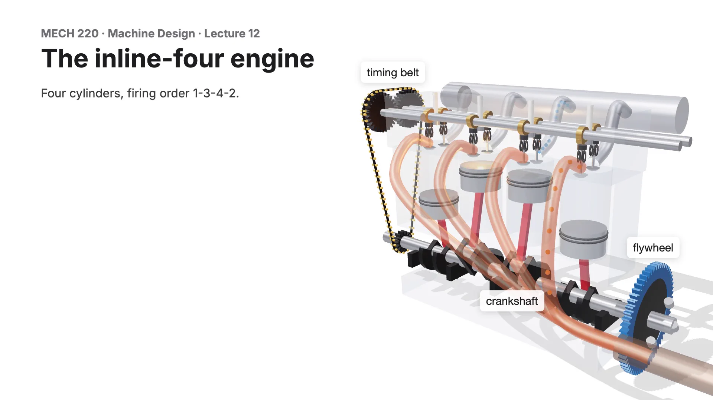
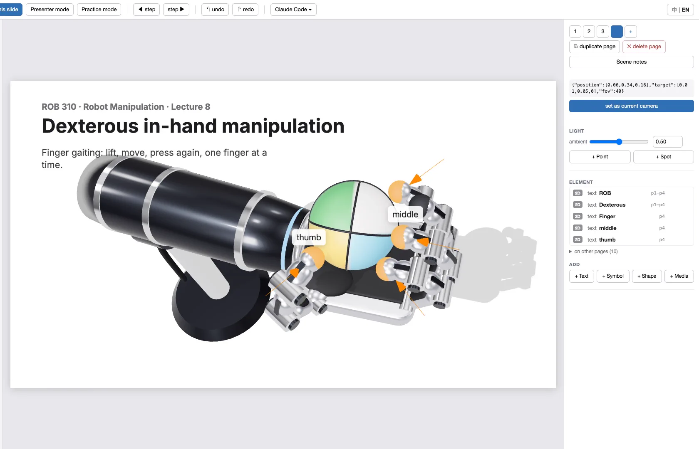
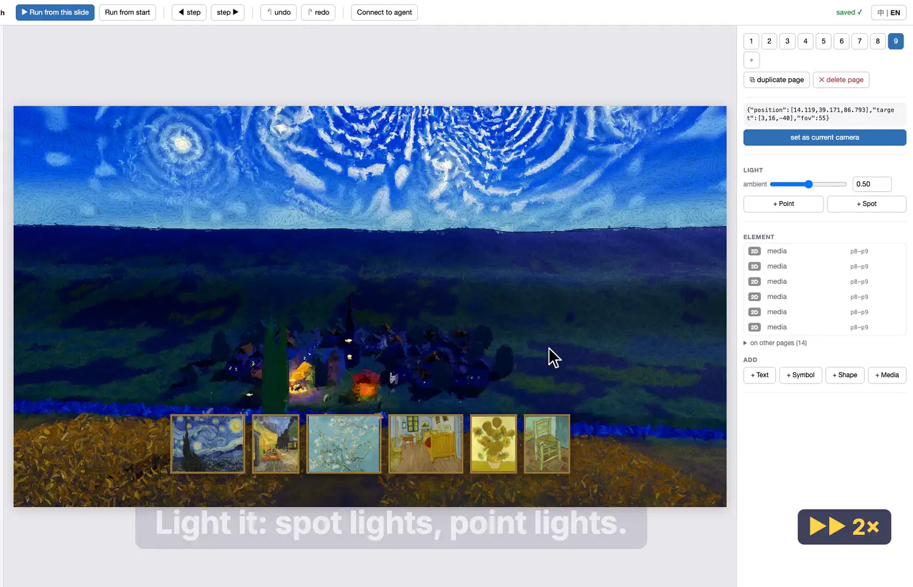
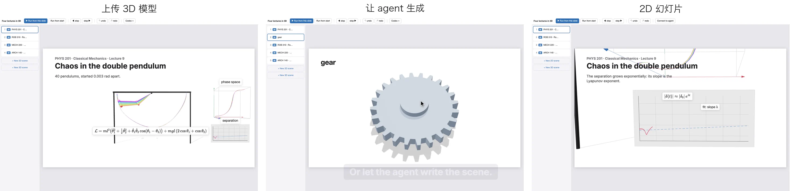
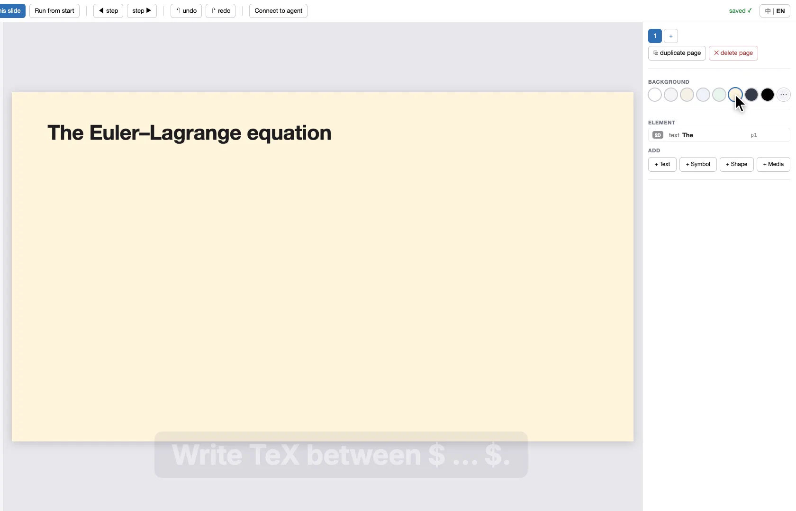
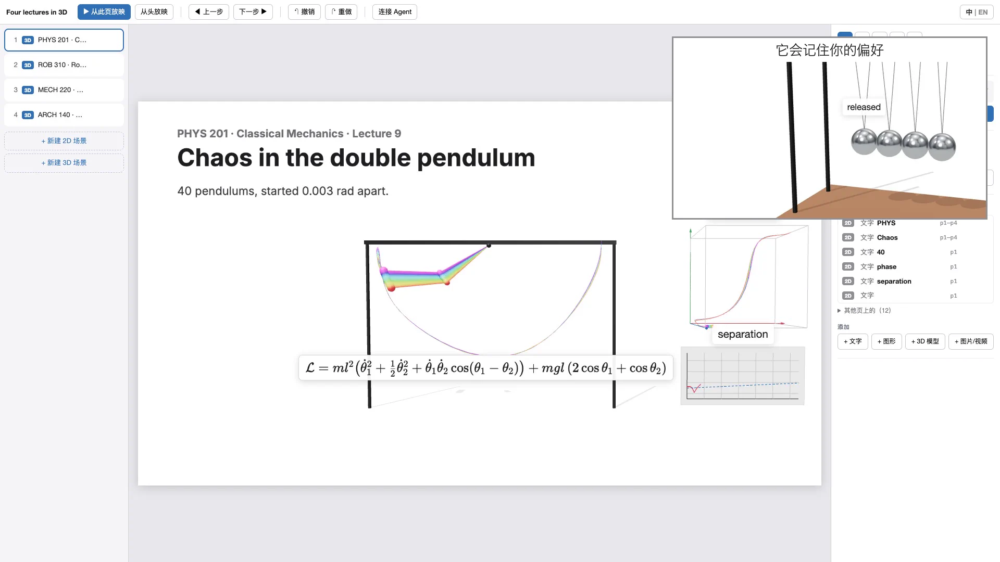
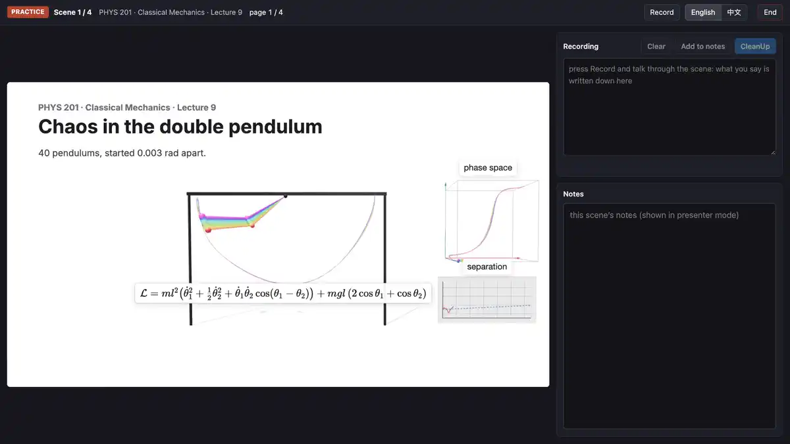

<a href="README.md">English</a> | <b>简体中文</b>

# 3D Slides

**不再是平面的幻灯片。** 每一页都可以是一个活的 3D 场景：镜头在页与页之间飞行，可以打光、放进你自己的模型，
也可以和普通的 2D 幻灯片混在一起，全部在浏览器里放映。AI agent 能替你搭场景、加页面，还会记住你的风格。

作者：[Yuanbo Li](https://liyb2002.github.io/)。欢迎 fork、改出你自己的版本，注明出处就行。

## 怎么用

1. clone 这个仓库。
2. 运行 `zsh code/tools/make_app.sh`（只需一次）或 `python3 code/serve.py`。
3. 双击任意 `.3Dslides` 文件（比如 `showcase.3Dslides`），或打开 http://localhost:8000/ 。

## 功能

### 1. 一页就是一个 3D 场景，放映时可以随意拖拽查看
放映时拖动转视角、滚轮缩放，按 **R** 平滑回到原视角。

### 2. 添加 page：移动镜头，保存视角
一个 page 就是一个镜头视角：移到想看的地方，点 **设为此页镜头**。放映时镜头会在页与页之间飞行。

### 3. 打光
任何一页都可以加聚光灯和点光源，调颜色、强度和照射范围。

### 4. 新建场景
上传 3D 模型，或者让 agent 直接生成场景。当然，也可以用普通的 2D 幻灯片。

### 5. 写 TeX 公式
在任何文本框里把 TeX 写在 `$...$` 之间。

### 6. 让 agent 帮你做，它还会记住你的偏好
**连接 Agent** 会在你的电脑上运行 [Codex](https://github.com/openai/codex)、[Kimi Code](https://www.kimi.com/code/docs/en/kimi-code-cli/reference/kimi-command.html) 或 [Qwen Code](https://qwenlm.github.io/qwen-code-docs/en/users/features/headless/)，替你搭场景、加页面，并把你的风格记在 `user/user_skills/`。

### 7. 练习模式：用语音写演讲备注
**练习模式**（Practice mode）会在你对着每个场景试讲时听写（Chrome 的语音识别，中文或英文）。录下的文字可以原样加进这个场景的备注，也可以点 **CleanUp**：agent 去掉口头禅和重复，保留你自己的说法。备注跟着场景走，不跟着页走；**演讲者模式**（Presenter mode）把备注和小屏幻灯片放在一起，全屏幻灯片在另一个窗口。

## 编辑器操作

| | |
|---|---|
| **P** / **Shift+P** | 从当前页放映 / 演讲者模式（**Esc** 返回） |
| **→** / **←** | 下一页 / 上一页 |
| 拖动、滚轮 | 转动、缩放 3D 视角（shift + 拖动：平移） |
| shift / ⌘ 点击，或在 2D 页上框选 | 选中多个元素，拖其中一个就一起移动 |
| ⌘A、⌘C、⌘V、⌘G、Delete | 全选、复制、粘贴、编组、删除 |
| ⌘Z / ⌘⇧Z | 撤销 / 重做 |
| 拖动左侧列表里的场景 | 调整场景顺序 |
| 右上角 中 \| EN | 切换编辑器的中英文界面 |
