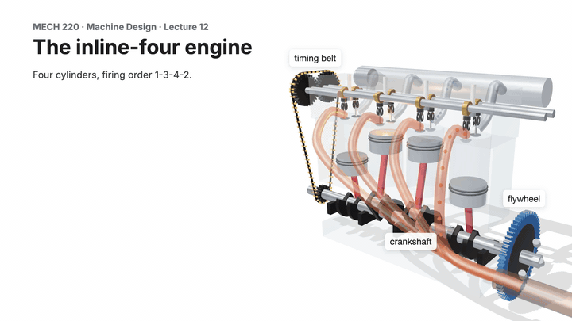
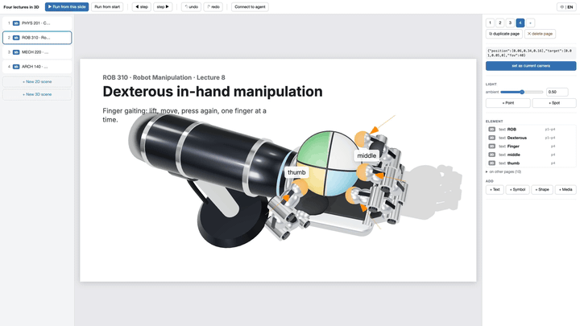
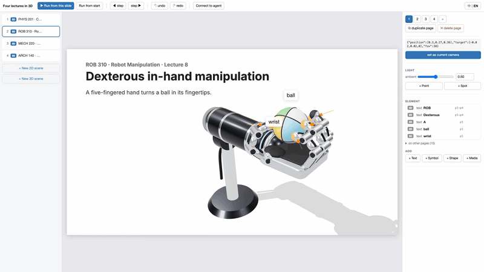
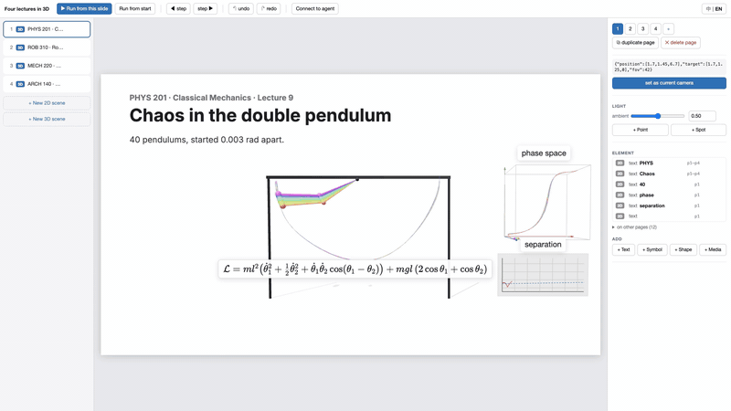
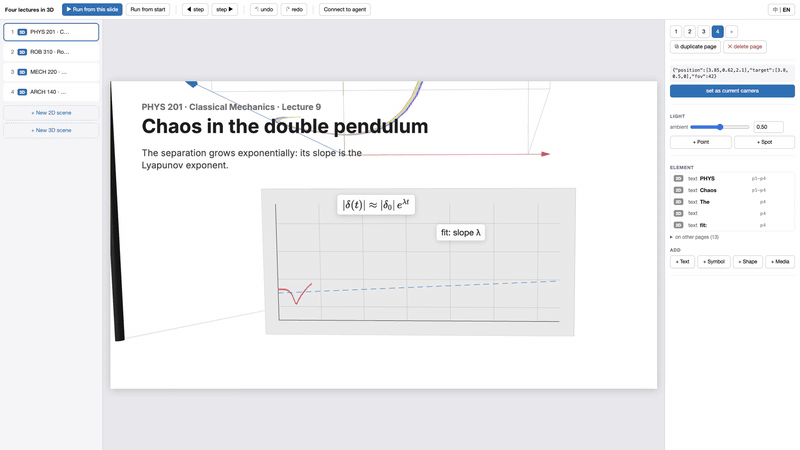
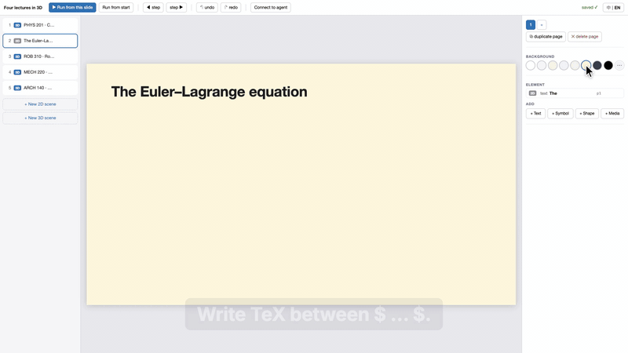
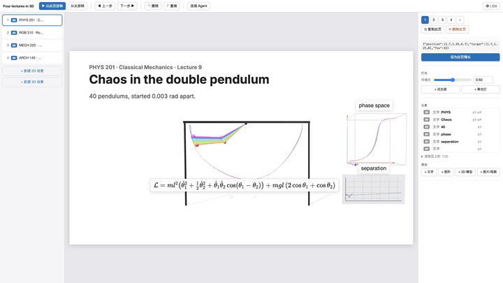
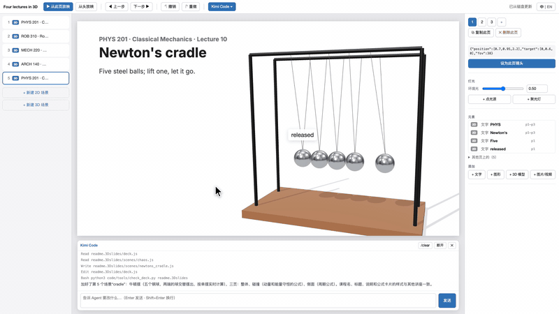

<p align="right"><a href="README.md">English</a> | <b>简体中文</b></p>

# 3D Slides

**不再是平面的幻灯片。** 每一页都可以是一个活的 3D 场景：镜头在页与页之间飞行，可以打光、放进你自己的模型，
也可以和普通的 2D 幻灯片混在一起，全部在浏览器里放映。AI agent 能替你搭场景、加页面，还会记住你的风格。

作者：[Yuanbo Li](https://liyb2002.github.io/)。

## 怎么用

在 Mac 上：

1. clone 下来后运行一次：`zsh code/tools/make_app.sh`
2. 之后双击任意 `.3Dslides` 文件（比如 `showcase.3Dslides`），就会在浏览器里打开编辑器。

不需要另外开任何东西：app 会自己在后台启动一个本地小服务器（已经有一个在跑就直接复用）。
需要 Python 3 和 Chrome。

其他系统，或者想用终端：`python3 code/serve.py`，然后打开 http://localhost:8000/ 。

## 功能

### 1. 一页就是一个 3D 场景，放映时可以随意拖拽查看
放映时拖动鼠标转视角、滚轮缩放，当着观众实时操作。按 **R** 平滑回到原来的视角。



### 2. 添加 page：移动镜头，保存视角
一个 page 就是一个镜头视角。添加 page，把镜头移到想看的地方，点 **set as current camera**（中文界面是“设为此页镜头”）。
放映时每点一下，镜头就飞到下一页。



### 3. 打光
任何一页都可以加聚光灯和点光源。在场景里直接拖动，调颜色、强度和照射范围。



### 4. 新建 3D / 2D 场景
**+ 新建 3D 场景**：上传一个模型（stl、obj、ply、glb、gltf、3mf），自动生成展示它的 3D 场景，可以直接转着看。



**+ 新建 2D 场景**：普通的幻灯片，可以放文字、图片、视频，背景色自己选。
从 3D 场景切到 2D 幻灯片只要点一下。



### 5. 写 TeX 公式
在任何文本框里用 `$...$` 写 TeX，编辑结束就会渲染成公式。



### 6. 让 agent 来做，它还会记住你的偏好
**连接 Agent** 会调用你自己电脑上的 [Kimi Code](https://www.kimi.com/code)、
[Qwen Code](https://github.com/QwenLM/qwen-code) 或 [Codex](https://github.com/openai/codex)（需要先装好并登录）。
让它新建场景或加页面，结果会直接出现在你的 deck 里。



关闭面板时，它会提议把你要求过的风格（字体、排版、颜色等）记到 `user/user_skills/` 里，下次一开始就按你的风格来。



## 编辑器操作

| | |
|---|---|
| **P** / **Shift+P** | 从当前页 / 从头放映（**Esc** 返回） |
| **→** / **←** | 下一页 / 上一页 |
| 拖动、滚轮 | 转动、缩放 3D 视角（shift + 拖动：平移） |
| shift / ⌘ 点击，或在 2D 页上框选 | 选中多个元素，拖其中一个就一起移动 |
| ⌘A、⌘C、⌘V、⌘G、Delete | 全选、复制、粘贴、编组、删除 |
| ⌘Z / ⌘⇧Z | 撤销 / 重做 |
| 拖动左侧列表里的场景 | 调整场景顺序 |
| 右上角 中 \| EN | 切换编辑器的中英文界面 |

## talk 是怎么存的

一个 talk 就是一个文件夹 `<名字>.3Dslides/`（生成 app 后，Finder 里会显示成一个文件）：

```
showcase.3Dslides/
  deck.js          talk 本身：一个导出所有幻灯片的 ES module（也可以直接手改）
  overrides.json   编辑器里还没写回 deck.js 的修改
  scenes/          deck.js 用到的 3D 场景（three.js）
  assets/          模型、图片、视频、上传的文件
```

编辑器里的修改能写回 `deck.js` 的都会直接写回。文件一变，所有打开的编辑器和放映标签页都会实时更新。

自带两个 talk：`showcase.3Dslides` 是四个简短的讲座（双摆混沌、灵巧机械手、直列四缸发动机、巴黎圣母院），
`demo.3Dslides` 是一次走进梵高画作的漫游。

## 致谢

作者：[Yuanbo Li](https://liyb2002.github.io/)。

基于 [three.js](https://threejs.org/) 和 [KaTeX](https://katex.org/)（都已放在 `code/vendor/` 里）。
`demo.3Dslides` 里的画作是来自 Wikimedia Commons 的公有领域图片。
